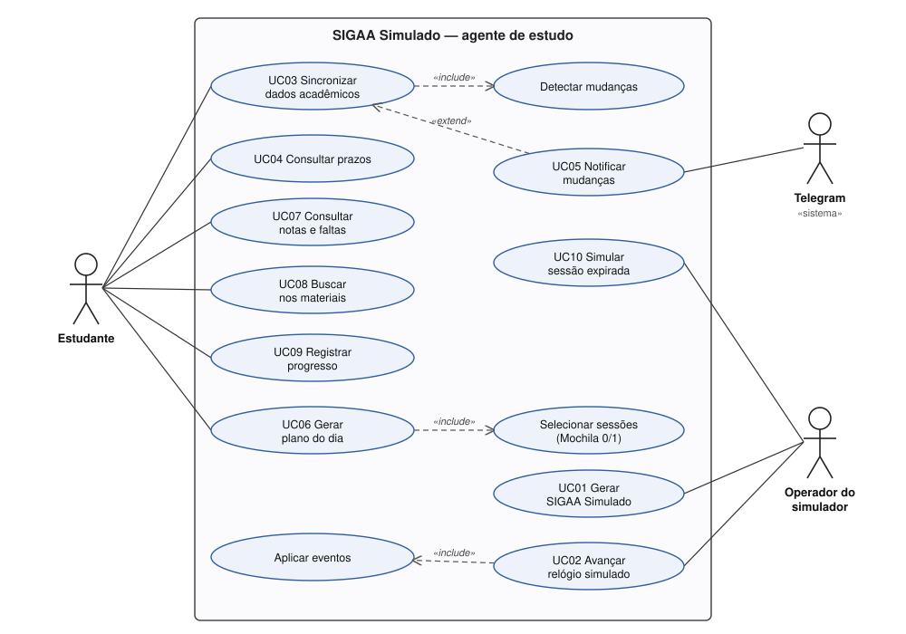

# Documento de Requisitos — SIGAA Simulado: agente de estudo

**Universidade Federal do Rio Grande do Norte**
Programação Avançada — 2026.2 · Prof. Dr. Hertz Wilton de Castro Lins · Projeto — II Unidade

**Equipe:** Victor Manuel Valentim Cordeiro (individual)
**Algoritmo:** nº 5 — Mochila Booleana (Knapsack 0/1), Programação Dinâmica
**Repositório:** <https://github.com/alphachief13/sigaa-simulado>

---

## 1. Introdução

### Motivação

As informações que um estudante precisa para se organizar ficam espalhadas pelo SIGAA: provas
no Plano de Curso de cada turma, tarefas no painel do portal, avisos em Notícias, materiais em
Arquivos e notas no relatório de cada turma. Mudanças como uma prova adiada ou uma nota lançada
só são percebidas quando o aluno entra em cada turma. Mesmo com tudo em mãos, sobra a
pergunta do dia: **com o tempo que tenho hoje, o que estudar?**

Estudar e testar um agente desses sobre o SIGAA real exige credenciais e dados pessoais, além
de depender de um sistema que muda. Também não permite repetir um cenário (por exemplo, "a
prova foi adiada").

### Objetivos

1. Disponibilizar um **SIGAA Simulado**: um banco acadêmico fictício, gerado por semente
   (reprodutível), que reproduz as estruturas observadas no portal e evolui no tempo
   (notícias, notas lançadas, provas adiadas, arquivos substituídos).
2. Disponibilizar um **agente de estudo** que sincroniza com esse SIGAA, detecta novidades e
   alterações e avisa o estudante.
3. Montar o **plano de estudo do dia** com a **Mochila 0/1**: escolher as sessões de maior
   valor (prioridade) que cabem no tempo livre.
4. Servir de **ambiente de estudo**: dados consistentes para consultas SQL, testes
   automatizados e demonstrações, sem acesso a nenhum sistema real.

## 2. Tecnologias

| Camada | Tecnologia | Uso |
| --- | --- | --- |
| Linguagem | Python 3.12 | todo o sistema |
| Persistência | SQLite (WAL, FTS5) | banco do SIGAA Simulado e banco do agente |
| Modelos e configuração | Pydantic 2, TOML | contratos de dados e `config.toml` |
| Interface | CLI (`argparse`) e web local (`http.server` + HTML/CSS/JS) | operação e painel |
| Extração de texto | pypdf, python-pptx | materiais (PDF/PPTX nas fixtures) |
| Qualidade | pytest (389 testes), ruff | validação e estilo |
| Ambiente | uv / venv | instalação reprodutível |
| Opcionais (desligados por padrão) | Telegram Bot API, Groq (LLM) | notificações e texto livre; sem eles, tudo funciona |

## 3. Painel MVP

| **É** | **Não é** |
| --- | --- |
| Um simulador **reprodutível** do SIGAA de um período letivo (mesma semente = mesmos dados). | Um cliente do SIGAA real: não faz login, não acessa a UFRN e não usa dados pessoais. |
| Um agente de estudo **local** para **um** discente (o "discente logado" do simulador). | Um sistema de gestão acadêmica: não matricula, não lança notas, não emite documentos. |
| Um planejador **diário** que respeita o tempo livre configurado. | Um aplicativo mobile ou um serviço multiusuário na internet. |
| Um ambiente de estudo de banco de dados, testes e algoritmos. | Um tutor que ensina o conteúdo ou corrige exercícios. |

| **Faz** | **Não faz** |
| --- | --- |
| Gera o banco fictício: 6 componentes, 8 turmas, 40 discentes (configurável), notícias, tópicos, arquivos, plano de curso, tarefas, notas e faltas de um período (17/08–19/12). | Não planeja vários dias de uma vez nem distribui carga pela semana. |
| Avança o relógio simulado e aplica eventos (prova adiada, prazo prorrogado, arquivo substituído); o relógio nunca volta. | Não desfaz eventos nem "volta no tempo"; para recomeçar, gera o banco de novo. |
| Sincroniza as 6 seções de cada turma e detecta itens novos, alterados (prazo, nota, material) e removidos (após 3 coletas completas sem o item). | Não marca item como removido por falha ou seção vazia sem evidência. |
| Monta o plano do dia com a Mochila 0/1: soma ≤ tempo livre, sessão ≥ 15 min, compromissos com prazo em até 21 dias. | Não garante o melhor plano pedagógico: é ótimo só para as prioridades calculadas. |
| Mostra prazos, notas, novidades e busca textual nos materiais. | Não envia mensagens sem configuração (Telegram desligado por padrão) e não depende de IA. |
| Registra o progresso das sessões (feito, pulado, dificuldade, observação). | Não avalia o desempenho real nem prevê notas. |

## 4. Estórias dos usuários

Atores: **Estudante** (discente logado), **Operador do simulador** (o aluno de PA ou o professor
que prepara cenários) e **Telegram** (sistema externo, opcional).

| ID | Estória | Prioridade |
| --- | --- | --- |
| EU1 | Como operador, quero gerar um SIGAA fictício a partir de uma semente para ter sempre o mesmo cenário de estudo. | Alta |
| EU2 | Como operador, quero avançar o relógio simulado para que provas sejam adiadas, notas lançadas e materiais trocados como num semestre real. | Alta |
| EU3 | Como estudante, quero sincronizar minhas turmas com um comando para ter avisos, prazos, notas e materiais num só lugar. | Alta |
| EU4 | Como estudante, quero ver meus próximos prazos em ordem de data, com disciplina e tipo (prova/entrega), para não perder nenhum. | Alta |
| EU5 | Como estudante, quero ser avisado quando um prazo mudar ou uma nota for lançada para não depender de abrir cada turma. | Alta |
| EU6 | Como estudante, quero informar quanto tempo tenho por dia para que o plano nunca passe desse limite. | Alta |
| EU7 | Como estudante, quero receber o plano de hoje com as sessões que trazem mais retorno para meu tempo livre, e saber por que cada uma foi escolhida. | Alta |
| EU8 | Como estudante, quero ver as minhas notas e faltas por disciplina. | Média |
| EU9 | Como estudante, quero buscar um termo nos materiais das turmas para achar onde um assunto foi tratado. | Média |
| EU10 | Como estudante, quero registrar se concluí ou pulei uma sessão e a dificuldade, para que o próximo plano considere o que falta. | Média |
| EU11 | Como operador, quero simular a expiração da sessão para verificar que o agente avisa e não apaga dados. | Baixa |
| EU12 | Como estudante, quero receber os avisos no Telegram, se eu configurar. | Baixa |

**Critérios de aceitação (estórias de prioridade alta):**

- **EU1.** Duas gerações com a mesma semente produzem tabelas idênticas. Sem `--sobrescrever`,
  o banco existente não é apagado.
- **EU2.** Só se aplicam eventos com `aplica_em ≤ novo relógio`, em ordem. Datas anteriores ao
  relógio são rejeitadas.
- **EU3.** A primeira coleta é registrada como *baseline* e gera um único resumo, sem uma
  notificação por item antigo.
- **EU5.** A alteração de prazo gera um evento `deadline_changed` e uma mensagem com a data antiga
  e a nova.
- **EU6/EU7.** A soma das sessões é ≤ minutos livres. Nenhuma sessão tem menos de 15 min. Cada
  sessão mostra o motivo (prazo em N dias, peso, materiais).

## 5. Protótipos (baixa resolução)

Cada componente atende duas estórias.

**P1 — Próximos prazos (EU4 + EU5)**

```
┌──────────────────────────────────────────────────┐
│ PRÓXIMOS PRAZOS             5 · próximos 21 dias │
├──────────────────────────────────────────────────┤
│ 21 out · 23h59 · em 2 dias             [entrega] │
│ Programação Avançada                             │
│ Documento de requisitos                          │
│ ················································ │
│ 05 nov · em 17 dias                   ! ALTERADO │
│ Programação Avançada · prova (antes: 02 nov)     │
│ Prova 2                                          │
│ ················································ │
│ Mostrando 1–3 de 5           [ Ver os outros 2 ] │
└──────────────────────────────────────────────────┘
```

**P2 — Plano de hoje (EU6 + EU7)**

```
┌──────────────────────────────────────────────────┐
│ PLANO DE 19/10 — 90 min livres          [editar] │
├──────────────────────────────────────────────────┤
│ 1. Programação Avançada — 35 min     [ok][pular] │
│    Documento de requisitos                       │
│    Por quê: prazo em 2 dias; peso 2              │
│ 2. Álgebra Linear — 35 min           [ok][pular] │
│    Prova 2 · Transformações lineares             │
│ 3. Álgebra Linear — revisão 15 min   [ok][pular] │
├──────────────────────────────────────────────────┤
│ Mochila 0/1: 3 de 39 candidatas · 85/90 min      │
└──────────────────────────────────────────────────┘
```

**P3 — Notas e materiais (EU8 + EU9)**

```
┌──────────────────────────────────────────────────┐
│ Disciplina: [ Física II              v ]         │
├──────────────────────────────────────────────────┤
│ NOTAS        | Buscar: [ gauss         ][Ir]     │
│ P1   6,8/10  | - Notas de aula — Lei de Gauss    │
│ T1   7,7/10  |   "...Lei de Gauss; simetrias"    │
│ P2   —       | - Notas — Campo elétrico          │
│ Faltas: 4    |                                   │
└──────────────────────────────────────────────────┘
```

**P4 — Controle do simulador (EU1 + EU2)**

```
┌──────────────────────────────────────────────────┐
│ SIGAA SIMULADO · semente 2026 · 2026.2           │
│ Relógio: 19/10/2026 09:00                        │
│ [ +1 dia ] [ +1 semana ] [ ir para: ____ ]       │
├──────────────────────────────────────────────────┤
│ PRÓXIMOS EVENTOS                                 │
│ 19/10 17:00  prazo prorrogado   Prob. e Est.     │
│ 28/10 14:00  prova adiada       Prog. Avançada   │
├──────────────────────────────────────────────────┤
│ [ Gerar de novo (nova semente) ] [ Sincronizar ] │
└──────────────────────────────────────────────────┘
```

## 6. Diagrama de casos de uso



| Caso de uso | Atores | Estórias |
| --- | --- | --- |
| UC01 Gerar SIGAA Simulado | Operador | EU1 |
| UC02 Avançar relógio simulado (inclui *Aplicar eventos*) | Operador | EU2 |
| UC03 Sincronizar dados acadêmicos (inclui *Detectar mudanças*) | Estudante | EU3, EU11 |
| UC04 Consultar prazos | Estudante | EU4 |
| UC05 Notificar mudanças (estende UC03) | Estudante, Telegram | EU5, EU12 |
| UC06 Gerar plano do dia (inclui *Selecionar sessões — Mochila 0/1*) | Estudante | EU6, EU7 |
| UC07 Consultar notas e faltas | Estudante | EU8 |
| UC08 Buscar nos materiais | Estudante | EU9 |
| UC09 Registrar progresso | Estudante | EU10 |
| UC10 Simular sessão expirada | Operador | EU11 |

## 7. Especificação dos casos de uso

### UC06 — Gerar plano do dia

- **Descrição:** monta a lista de sessões de estudo do dia a partir dos compromissos
  sincronizados.
- **Resultado desejado:** um plano salvo (versão N) com sessões cuja soma não passa do tempo
  livre, cada uma com objetivo, motivo, passos e materiais.
- **Objetivos do usuário:** saber o que estudar hoje e por quê, sem estourar o tempo.
- **Participantes / papéis:** Estudante (solicita, informa a disponibilidade); sistema
  (calcula a prioridade, resolve a mochila e valida o plano).
- **Pré-condições:** pelo menos uma sincronização concluída (UC03); disponibilidade do dia
  configurada.
- **Início:** o estudante executa `sigaa-sim plan` ou abre "Plano de hoje".
- **Fim:** o plano é exibido e gravado (`plans`, `study_tasks`).

**Cenário principal**

1. O estudante pede o plano de uma data (padrão: hoje no relógio simulado).
2. O sistema lê a disponibilidade do dia (ex.: segunda = 90 min).
3. O sistema seleciona tarefas e avaliações com prazo entre hoje e hoje + 21 dias e calcula a
   prioridade de cada uma.
4. O sistema gera as sessões candidatas (sessões de 35 min com valor decrescente e uma revisão
   de 15 min por compromisso).
5. O sistema resolve a **Mochila 0/1** com capacidade = minutos ÷ 5.
6. O sistema ordena as sessões escolhidas por prioridade e prazo, associa os materiais mais
   relacionados e cria os passos.
7. O sistema valida o plano e o grava com a nota "Mochila 0/1: k de n candidatas, x/y min".
8. O sistema exibe o plano.

**Cenários alternativos**

- **A1. Plano já existe para a data:** o sistema exibe o existente. Se os prazos ou a
  disponibilidade mudaram desde então, replaneja (nova versão) e avisa "(compromissos ou
  disponibilidade mudaram)".
- **A2. Disponibilidade 0:** grava um plano vazio com a nota "sem disponibilidade configurada".
- **A3. Nenhum compromisso no horizonte:** grava um plano vazio com a nota "nenhum
  prazo/avaliação no horizonte".
- **A4. Tempo livre < 15 min:** plano vazio com a nota "tempo disponível abaixo da sessão
  mínima".
- **A5. IA habilitada:** a sugestão da IA é validada (passos 7). Se for rejeitada ou estiver
  indisponível, o sistema segue a partir do passo 4 e registra o motivo.
- **A6. `--new`:** força uma nova versão mesmo sem mudanças.

**Regras de negócio**

- RN01: soma das durações ≤ minutos livres do dia.
- RN02: nenhuma sessão abaixo de `min_session_minutes` (15).
- RN03: só entram compromissos com prazo em `[hoje, hoje + 21 dias]`.
- RN04: prioridade = `6/(1+dias) + 1,5·min(peso/10,1) + 0,5·min(freq,5)/5 + 1,0·pendência`.
- RN05: a k-ésima sessão do mesmo compromisso vale prioridade × 0,6ᵏ; a revisão curta vale × 0,3.
- RN06: material citado precisa existir; disciplina citada precisa estar entre os compromissos.

### UC03 — Sincronizar dados acadêmicos

- **Descrição:** coleta as 6 seções de cada turma no SIGAA Simulado e compara com o estado salvo.
- **Resultado desejado:** banco do agente atualizado e eventos de mudança registrados.
- **Objetivos do usuário:** ter tudo atualizado num lugar só.
- **Participantes / papéis:** Estudante (dispara); SIGAA Simulado (fonte); Telegram (UC05,
  opcional).
- **Pré-condições:** banco simulado gerado (UC01); nenhuma outra sincronização em andamento
  (trava).
- **Início:** `sigaa-sim sync`. **Fim:** resumo "coleta: success | novos/alterados/removidos".

**Cenário principal**

1. O sistema obtém a trava de execução.
2. O sistema autentica na sessão simulada.
3. O sistema lista as turmas do discente logado.
4. Para cada turma e seção (notícias, tarefas, avaliações, notas, conteúdo, arquivos), o sistema
   coleta só o que já foi publicado segundo o relógio.
5. O sistema converte os registros (datas `dd/mm/aaaa`, notas com vírgula) e calcula o hash
   dos campos relevantes.
6. O sistema compara com o estado atual e grava novos itens, revisões e eventos (`created`,
   `deadline_changed`, `grade_changed`, `material_replaced`).
7. O sistema enfileira notificações e downloads de materiais e libera a trava.

**Cenários alternativos**

- **A1. Primeira coleta (baseline):** grava tudo sem notificar item por item; envia um resumo.
- **A2. Sessão expirada (UC10):** a coleta termina como `failed/needs_interaction`, nada é
  apagado e um alerta único por dia pede `simulador sessao --renovar`.
- **A3. Seção vazia com evidência** ("Ainda não foram lançadas notas."): status `empty`,
  sem remover itens. **Sem evidência**: status `failed`.
- **A4. Item ausente:** só é marcado como removido após 3 coletas completas seguidas sem ele.
- **A5. Outra sincronização em andamento:** encerra com "outra execução em andamento (pid N)", código 2.
- **A6. Banco simulado inexistente:** "rode `sigaa-sim simulador gerar`".

**Regras de negócio**

- RN07: identidade do item = `instituição:conta:período:turma:tipo:id_fonte`.
- RN08: datas sem hora permanecem sem hora (nunca inventar 23:59).
- RN09: falha numa seção não altera os itens dessa seção.

### UC02 — Avançar relógio simulado

- **Descrição:** move o "agora" do SIGAA Simulado e aplica a linha do tempo de eventos.
- **Resultado desejado:** relógio no novo instante e eventos vencidos aplicados.
- **Objetivos do usuário:** reproduzir a evolução de um semestre.
- **Participantes / papéis:** Operador.
- **Pré-condições:** banco simulado gerado.
- **Início:** `sigaa-sim simulador avancar --dias N` ou `--ate AAAA-MM-DD[THH:MM]`.
- **Fim:** lista "eventos aplicados" e lembrete de sincronizar.

**Cenário principal**

1. O operador informa o deslocamento ou a data alvo.
2. O sistema valida que o alvo ≥ relógio atual.
3. O sistema aplica, em ordem de `aplica_em`, cada evento pendente com `aplica_em ≤ alvo`.
4. O sistema grava o novo relógio na mesma transação e lista os eventos aplicados.

**Cenários alternativos**

- **A1. Alvo no passado:** erro "o relógio não volta no tempo", nada muda.
- **A2. Evento que altera coluna não permitida:** erro, a transação é desfeita e o relógio fica
  como estava.
- **A3. Nenhum evento no intervalo:** só o relógio avança; novas notícias/notas aparecem pela
  data de publicação.

**Regras de negócio**

- RN10: eventos só alteram `avaliacao_plano.{data, descricao, conteudo}`,
  `tarefa.{fim, descricao, titulo}`, `arquivo.{conteudo, versao, descricao, nome}` e
  `topico_aula.{conteudo, titulo}`.
- RN11: o relógio do agente é o relógio do simulador (perfil `simulado`).
