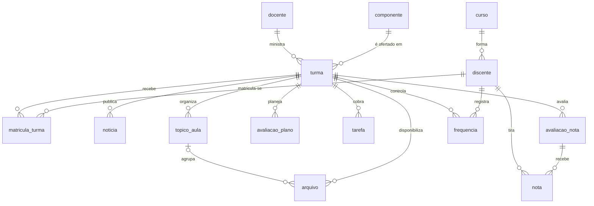

# SIGAA Simulado

Banco SQLite **fictício** e determinístico que substitui o portal SIGAA. Ele reproduz as
entidades e os formatos observados no SIGAA da UFRN (turmas JSF, notícias, plano de curso,
relatório de notas, tópicos de aula e arquivos), mas não acessa nenhum sistema real: não há
login, rede ou credenciais.

Tudo é controlado pelo painel (`sigaa-sim web` → **Controle**):

| No painel (Controle) | O que faz | Equivalente na CLI (opcional) |
| --- | --- | --- |
| **Preparar tudo** / **Gerar SIGAA** (semente, discentes, relógio inicial) | cria `data/sigaa_simulado.db` | `simulador gerar --semente 2026` |
| **Info do simulador** | contagens, relógio, turmas do discente logado | `simulador info` |
| **Próximos eventos** / **Todos os eventos** | linha do tempo de alterações | `simulador eventos [--todos]` |
| **+1 hora**, **+1 dia**, **+1 semana**, **Avançar**, **Avançar até** | move o relógio e aplica eventos vencidos | `simulador avancar --dias 3` |
| **Expirar sessão** / **Renovar sessão** | simula a sessão expirada | `simulador sessao --expirar` (e `--renovar`) |

## Do portal real para o modelo

| Estrutura observada no SIGAA | Tabela simulada | O adapter devolve |
| --- | --- | --- |
| Portal do discente, `#turmas-portal`; `idTurma` numérico estável | `turma`, `matricula_turma`, `componente`, `docente` | `Course` com `source_id = id_turma` |
| Painel "Minhas atividades" (tarefas com prazo e hora) | `tarefa` | `deadline` `dd/mm/aaaa hh:mm`, peso |
| Turma → Notícias (`table.listing`: título, data, corpo) | `noticia` | `published` `dd/mm/aaaa hh:mm` |
| Turma → Plano de Curso (`#listaAvaliacoes`: data + descrição) | `avaliacao_plano` | `deadline` só com data (sem hora inventada), escopo da unidade |
| Turma → Ver Notas (`th#aval_<id>` com `denAval`, `notaAval`, `pesoAval`; colunas Faltas/Sit.) | `avaliacao_nota`, `nota`, `frequencia` | nota com vírgula (`7,5`), máximo, rótulo, faltas |
| Página da turma, `div.topico-aula` "Título (dd/mm/aaaa - dd/mm/aaaa)" | `topico_aula` | data inicial e final |
| Turma → Arquivos (nome, descrição, tópico, download por popup) | `arquivo` | `sim://arquivo/<idTurma>/<idArquivo>` |
| Mensagens de vazio (`ul.warning`, `p.empty-listing`) | (sem linhas) | `EMPTY` + o mesmo texto como evidência |
| Redirecionamento ao CAS (sessão expirada) | `sim_meta.sessao` | `needs_interaction` |

Horários usam a notação do SIGAA: `24T12` = segunda e quarta (2, 4), turno da tarde (T), aulas
1 e 2. Matrículas têm 11 dígitos (ano + período + sequencial).

## Modelo de dados



`evento` e `sim_meta` (relógio, semente, discente logado, sessão) ficam fora das relações.

## Tempo simulado

- Cada registro tem um instante de publicação (`publicado_em`; nas notas, `lancada_em`). O
  adapter só mostra o que já foi publicado segundo o **relógio simulado** (`sim_meta.relogio`).
- Alterações posteriores ficam em `evento` (`prova_adiada`, `prazo_prorrogado`,
  `arquivo_substituido`) e são aplicadas em ordem por `simulador avancar`. Cada evento só pode
  alterar as colunas listadas em `COLUNAS_ALTERAVEIS`, e o relógio nunca volta.
- O relógio do agente (`SimClock`) é o mesmo do simulador. Assim, lembretes e o plano do dia
  usam o "agora" fictício.
- Padrão: período 2026.2 (17/08 a 19/12), dividido em 3 unidades. O relógio inicial fica 9
  semanas após o início (19/10/2026, meio da 2ª unidade), com provas e entregas nos 21 dias
  seguintes.

## Geração

`sigaa_sim/simulador/gerador.py`, com semente (`random.Random(semente)`):

1. Cursos, 8 docentes e 6 componentes do catálogo (`catalogo.py`, códigos `SIM*`).
2. Turmas: componentes de 90 h têm 2 turmas e os demais têm 1. Os horários não se repetem.
3. Discentes (padrão 40) matriculados em 5 componentes cada. O primeiro é o **discente logado**.
4. Para cada turma: tópicos distribuídos pelo semestre, cada um com notas de aula em Markdown;
   avaliações por unidade (plano e coluna de notas); notas ~N(7; 1,8) limitadas a [0, máximo]
   e lançadas 5–12 dias após a avaliação; tarefas; notícias (boas-vindas, material da semana,
   lembrete de prova); faltas.
5. Eventos: provas adiadas (com notícia e notas relançadas depois da nova data), prazos
   prorrogados e arquivos substituídos por uma versão com errata.
6. Os eventos anteriores ao relógio inicial já saem aplicados.

A mesma semente produz exatamente os mesmos dados (`tests/test_simulador.py`).

## Consultas úteis para estudo

```sql
-- média ponderada de cada discente por turma (só notas já lançadas)
SELECT n.matricula, a.id_turma, ROUND(SUM(n.valor * a.peso) / SUM(a.peso), 2) media
FROM nota n JOIN avaliacao_nota a ON a.id = n.id_avaliacao
WHERE n.lancada_em <= (SELECT valor FROM sim_meta WHERE chave = 'relogio')
GROUP BY n.matricula, a.id_turma;

-- choques de horário entre turmas de um discente
SELECT mt.matricula, t1.horario, t1.componente, t2.componente
FROM matricula_turma mt
JOIN turma t1 ON t1.id_turma = mt.id_turma
JOIN matricula_turma mt2 ON mt2.matricula = mt.matricula AND mt2.id_turma > mt.id_turma
JOIN turma t2 ON t2.id_turma = mt2.id_turma AND t2.horario = t1.horario;
```
